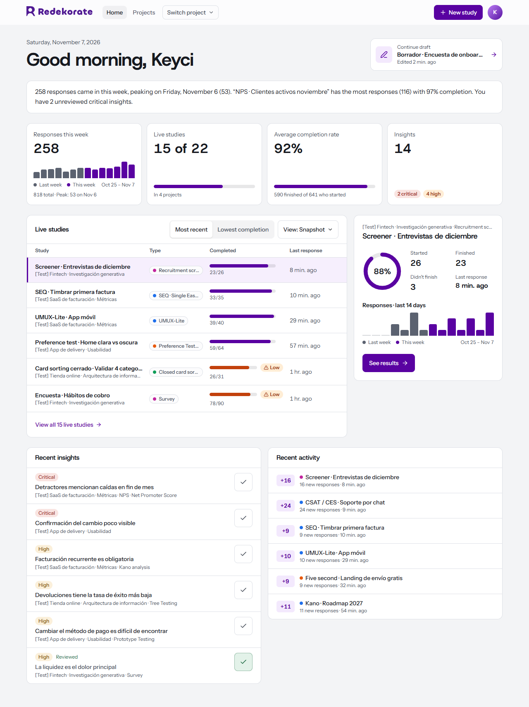

# redekorate · UX research platform

[](https://github.com/keyci1113/redekorate/actions/workflows/ci.yml)
[](LICENSE)

A self-hosted UX research tool in the spirit of Maze: create a project, pick a method, configure it, send a link to real participants and share a report with insights. Bilingual UI (Spanish / English), one Docker Compose file to run it.

[Leer en español](README.es.md)

Created by **Keyci Padilla**.



## Features

**Research methods**

| Category | Ready |
|---|---|
| Prototypes | **Prototype Testing** and **unmoderated Usability Test**: uploaded screens with clickable zones or a single-file HTML prototype, direct/indirect success, expected-path funnel, most common paths, heatmaps and off-target clicks per screen |
| Usability | First Click (click map and correct area), Five Second, A/B Preference Test with images, Tree Testing (direct/indirect success and destinations) |
| Information architecture | Open, closed and hybrid Card Sorting (agreement per card, similarity matrix with clustering, created categories) |
| Generative | Survey, Screener, Feature prioritization (ranking + matrix), Kano model |
| Metrics | SUS (with the Sauro-Lewis scale), NPS with detractor/promoter logic, CSAT/CES, SEQ, UMUX-Lite |
| Organization | Insight repository with review status, participant panel, shareable reports per study or per project |

**Images** on blocks, branding and prototypes are optimized in the browser before upload: resized to at most 2048 px on the longest side and re-encoded as WebP (PNG or JPEG where the browser cannot encode WebP). GIFs are kept as they are, and a file is only replaced when the result is smaller.

**Blocks** combine freely in a "Blank study": Welcome, Instructions, Thank you, Open question, Multiple choice, Dropdown (one answer from a long list, with an optional "Other"), Yes/No, Scale (numbers, stars or emojis), Ranking, Matrix, NPS, SUS, Card Sorting, Tree Test, Preference, Five Second, First Click, Timed task. Every block accepts an optional image.

**Conditional logic** is written in plain language, for example "if the answer is less than 7 → go to…". It works with options, Yes/No, scales, NPS, preference, and pass/fail in tree tests, first click, prototype tasks and timed tasks. Jumps only go forward, so no cycles can form.

**Fillable documents.** Each project has a Documents tab with 20 templates: UX Project Blueprint, Proto-persona, Persona canvas, User persona, User Journey Map (the emotion curve draws itself), Affinity diagram, Empathy Map, Stakeholder Map, Cognitive Mapping, User / Task Flow, Service Blueprint, Jobs To Be Done, Interview guide and notes, AEIOU observation, Behavioral observation, Time study (an observer logs every activity of a workday with start, end, activity bucket and main tool; the summary computes days observed, hours logged, average per day, hours in the tools being measured, and hours, share and weekly estimate per activity and per tool; a second observation round, such as after an AI rollout, turns on a *Before and after* tab that compares hours per person per week by activity and by tool), Diary Study, Usability test script, Usability test results (computes per-task and total rates) and Heuristic evaluation (Weinschenk or Nielsen, several evaluators, severity 0–4). Documents start empty; examples appear only as placeholder text and are never saved. They autosave, support "Save as…" into this or another project, export to **Word (.docx), PDF, Markdown and CSV** from the browser, and can be shared with a revocable read-only link. Each document has its own language.

**Architecture.** Each project has an *Architecture* tab for diagrams, in two kinds. A **diagram** is a whiteboard canvas like FigJam: rectangles, process steps, ellipses, decisions, triangles, input/output, hexagons, databases, information-architecture pages and page groups, sticky notes, free text and sections (frames that carry the shapes inside them when moved), in eight colors and three text sizes. Shapes are joined by dragging from any of their four dots to another shape, or anywhere on it; letting go on empty canvas creates a new shape already joined. Arrows can be solid or dashed, point one way, both ways or neither, run as elbows, curves or straight lines, and carry a label. Double-click to write, with bold, italic, underline, strikethrough, bulleted and numbered lists, four text sizes, left/center/right and top/middle/bottom alignment and a text color; shapes grow taller as you type. One-key shortcuts for the common shapes (R, O, D, P, S, T, F), undo and redo, copy, paste and duplicate, pan and zoom with a minimap, and export to PNG or SVG. A **sitemap** is information architecture written as an indented outline, one page per line, and drawn as a tree as you type: the home page on top, sections in a row, the rest stacked under each section. *Open as diagram* turns it into a canvas to arrange and annotate by hand. New diagrams can start blank or from a sitemap, user flow, flowchart or system architecture starter in Spanish or English. Diagrams are stored as documents, so they autosave, take comments, *Save as…* into another project and share with the same revocable read-only link; outside assistants read the format with the `diagram_reference` MCP tool.

**Voice answers.** On open questions and on the "why did you choose this?" follow-up, participants can tap *Answer by voice* and speak instead of typing. The browser transcribes as they talk, the text lands in the same field and they can correct it before continuing. The field tells them their voice is not recorded or stored, before and while they speak. No audio is recorded, uploaded or stored by redekorate; only the resulting text is saved, like a typed answer. Recognition runs in the study language. It uses the browser's built-in speech recognition (Chrome, Edge and Safari; in Chrome and Edge the browser sends the audio to its vendor's speech service to transcribe it), so where it is unavailable, as in Firefox, the field simply shows without the microphone. Some Chromium browsers (Dia, Brave, Vivaldi) offer the feature but cannot transcribe; there the first attempt explains it and the microphone is withdrawn for the rest of the visit. Turn it off per study under *Design → Allow voice answers*.

**Participants.** A public link, no account needed, mobile-friendly, with optional informed consent. A per-project participant panel keeps a recruiting base (name, contact, tags, consent) and the history of which studies each person was invited to and how it went.

**Results.** Automatic analysis per method, per-participant detail, CSV export, insights with severity and review status, and public reports that combine one or several studies and can be revoked at any time.

## How it flows

1. **Home:** a dashboard with live studies, responses over the last 14 days, recent activity, drafts and insights.
2. **Project:** creating one takes you straight to choosing a method. Search it, filter by category or start from your question ("Can people use my design?").
3. **Template:** each method shows its blocks, a step-by-step guide, the duration and the recommended sample before you create it.
4. **Builder:** drag blocks to reorder, edit content and logic, preview on desktop or mobile, adjust branding and run a pre-publish review.
5. **Participants:** share the public link. Once a study is live, your edits are saved as a draft and participants keep seeing the published version until you press **Publish changes**; anyone mid-flow finishes with the version they started.
6. **Results:** analysis, insights and a shareable report.

## Prototype testing

**Image prototypes**

1. In Figma, select your frames and use **Export → PNG 2x**.
2. In the builder, open **Prototypes** and drop all the screens at once; the file name becomes the screen name.
3. Draw clickable zones by dragging over each screen and choose where they lead (another screen or "back"). Zones can be moved and resized, and **Try** mode lets you navigate the prototype.
4. In each task choose the start screen, the goal screen and, optionally, the expected path. Screens are resized to at most 2048 px and re-encoded as WebP in your browser before upload, so even 2x desktop exports stay light.
5. The participant sees the task, navigates the prototype inside a phone or desktop frame (full screen on their phone) and can mark "I can't complete it". Every click is stored with coordinates, path and timings.

**HTML prototypes** (for example, made with Claude)

1. Ask Claude for the prototype as **a single .html file** and download it (a `.jsx` component will not work).
2. In **Prototypes**, create a new one and use **Upload HTML**. There are no zones to draw.
3. Navigate it in the editor: every screen you visit appears under **Detected screens**. Screens are recognized by a `data-screen="Name"` attribute, by the URL `#` hash or by the visible `<h1>`. The editor includes a ready-to-copy instruction to ask Claude to add `data-screen` attributes.
4. Once screens are detected, define the **flow** in the right panel: where it starts, where it ends, which screens it passes through and the instructions for the participant. When a task opens, the prototype is asked to show the start screen: by URL hash if it has one, otherwise by tapping the element with that name, so a start screen that sits behind a login can't be reached unless the prototype exposes it by hash (the Claude instruction in the editor asks for that). For steps inside a screen, such as opening a tab, add **required interactions**: press *Record clicks* and tap the elements in the preview, or type the element's text; any step can become the goal. Tasks that use the prototype pick that flow up as their goal, expected path, required interactions and description; you can still adjust each task. Results show how many participants performed each interaction and how long it took them. Without a goal, the participant taps "I'm done" (self-reported success, not verified).
5. The path, timings and every click with the element's text are stored. Instead of heatmaps, results show the most-tapped elements per screen and **clicks with no response** (taps on something that is not interactive).

**Published link** (Figma Make, a deployed site…)

1. Publish the prototype and copy its public link. For Figma Make that is the `….figma.site` address, not the editor URL.
2. In **Prototypes**, paste it under **Published link**. The server checks that the site allows being embedded and the prototype is shown as is inside the task.
3. Nothing of ours runs on that site, so only the time and the participant's own "I'm done" or "I can't complete it" are recorded; there are no clicks, screens or heatmaps. claude.ai blocks embedding, so a Claude link is refused with a pointer to the HTML upload above.

> **Why not just paste the Claude link?** claude.ai does not allow other sites to embed its artifacts in an iframe (`frame-ancestors`), so the prototype is uploaded as a file. The server injects a tracking script and serves it with a CSP `sandbox` (opaque origin): the HTML cannot read the session or call the API, and it can only be embedded from the app.

> **Why not connect to Figma directly?** Figma's Embed API is free, but it only sends events when the participant is signed in to Figma (confirmed by Figma support in January 2026), and clicks are relative to the layer that was hit, not to the screen. With uploaded screens any anonymous participant works and heatmaps are accurate.

## First run and help

A new account opens a short welcome wizard: profile (photo, name, interface language), workspace (personal, or create an organization), a first project and a first study from a recommended method. Every step can be skipped and *Finish later* leaves at any point; the account remembers it, so the wizard shows once per person, not per browser. People who arrive through an organization or project invitation skip the steps they don't need.

The Home shows a *Getting started* checklist (project, study, publish, first response, shared report) checked off from real data until it is complete or hidden. *Help and concepts* in the account menu has how-tos for the main tasks and a glossary of the words the interface uses, and lets you replay the wizard.

## Users and roles

Every instance has two roles. The first account ever created is the **admin**; everyone else is a **member**.

- **Members** work in their own projects, exactly as before.
- **Admins** see a *Users* page in the account menu where they invite people by email (the invitation is valid for 7 days and works even with `ALLOW_REGISTRATION=false`), change roles, and disable or reactivate accounts. Disabling an account closes its sessions immediately. There must always be at least one active admin, and you can't demote or disable yourself.

Without SMTP configured, the admin gets the invitation link to copy instead of an email being sent.

### Sign in with Google or Microsoft

Optional. When a provider's credentials are in `.env`, a *Continue with Google / Microsoft* button appears on the login and invitation pages, and *My account* gets a *Linked accounts* section to link or unlink either provider and to create a password for accounts that were created through a provider.

| Variable | Value |
|---|---|
| `GOOGLE_CLIENT_ID`, `GOOGLE_CLIENT_SECRET` | OAuth client of type *Web application* in [Google Cloud Console → Credentials](https://console.cloud.google.com/apis/credentials); authorized redirect URI `https://<your-domain>/api/auth/oauth/google/callback` |
| `MICROSOFT_CLIENT_ID`, `MICROSOFT_CLIENT_SECRET` | App registration in [Entra admin center](https://entra.microsoft.com) with a *Web* redirect URI `https://<your-domain>/api/auth/oauth/microsoft/callback` and a client secret; ID tokens enabled |
| `MICROSOFT_TENANT` | `common` (any Microsoft account), `organizations` (work or school only), `consumers`, or your tenant ID or domain to restrict sign-in to one company |

How accounts are matched: the provider's stable subject is stored per user, so the same Google or Microsoft account always opens the same Redekorate account even if the email changes later. On first use, a provider account whose **verified** email matches an existing user is linked to that user (Google asserts `email_verified`; Microsoft emails come from the organization's domain or from a verified personal account). Otherwise a new account is created, following the same rules as the form: the first account is admin, `ALLOW_REGISTRATION=false` blocks it unless the person arrives through a pending invitation sent to that same email. Accounts created this way have no password; they can set one from *My account*, and the last remaining sign-in method can never be removed. The flow is OpenID Connect authorization code with PKCE, state and nonce; the ID token signature is checked against the provider's published keys and no access token is stored.

**Project collaborators.** The person who creates a project owns it and can add any existing account from the project's *Collaborators* tab with one of three roles:

| Role | Can |
|---|---|
| Editor | Create and change studies, documents, insights, participants and shared reports |
| Commenter | Everything read-only can, plus leave comments on the project, on study results and on documents |
| Read-only | Open results, documents and reports; the builder redirects to results and documents open read-only |

Only the owner adds or removes people, archives or deletes the project, or moves it into an organization. Collaborators can leave a project themselves. The dashboard counts shared projects too, and any collaborator can preview a draft study.

**Organizations.** Anyone can create an organization from the account menu: a workspace with a name, a logo and a color, for a company, a team or a personal studio. A project is either personal or belongs to one organization (chosen when creating it, or moved later by its owner from *Edit project*).

| Organization role | Can |
|---|---|
| Owner | Everything, including deleting the organization |
| Admin | Change the profile, add or remove people, send invitations |
| Member | See every project of the organization as a **commenter** |

Owners and admins act as owners of every organization project. When a project has an explicit collaborator role and an organization role, the higher one wins. New studies in an organization project start with the organization's logo and color as their brand, and public reports show the logo next to Redekorate's. People who already have an account are added by email; people who don't get a 7-day invitation link that creates the account and joins the organization. Deleting an organization never deletes projects: they become personal projects of their owners again.

## Connect AI apps (MCP)

Redekorate is also an [MCP](https://modelcontextprotocol.io) server at `<APP_URL>/mcp`, so Claude, ChatGPT, Cursor and other AI apps can work in your projects: list projects and studies, read results, draft or edit studies, launch or close them, and write insights and documents. They act as you, with your role in each project, and can never delete anything. Results reach them without the participant details a link may carry, and without emails or phone numbers participants typed into their answers.

- **Safe edits.** `update_study` and `update_document` replace content: they need the `updated_at` the assistant read (`base_updated_at`), so a newer edit is never overwritten (409); they refuse to empty existing content; and every version they replace is saved (migration 019, last 30 per item), so `list_versions` and `restore_version` undo a bad write. Study blocks, diagrams and document sections an assistant sends are checked before saving, and a misspelled argument is refused by name.
- **Asking first.** Tools that replace content or change what participants see are marked `destructiveHint`, so Claude asks before running them. Launching a live study again or publishing an unchanged draft changes nothing.
- **Outside text is data.** Study answers carry an `untrusted_content` notice, and the server's instructions tell assistants never to act on requests written in them.
- **Rate limit.** 240 calls a minute per account (all of its tokens together); calls without a valid token count per address.

- **Claude.ai or ChatGPT:** add a custom connector with the address shown under *My account → Outside access (MCP)* and sign in. You approve the app on a consent screen; *My account* lists connected apps and removes their access.
- **Claude Code, Claude Desktop, Cursor or scripts:** create an access token in the same section (shown once, 30 days to no expiry) and send it as a bearer token, e.g. `claude mcp add --transport http redekorate https://research.yourdomain.com/mcp --header "Authorization: Bearer rdk_pat_…"`. Clients that support OAuth can skip the token and sign in instead.

Under the hood: OAuth 2.1 with dynamic client registration and PKCE (S256) for public clients, one-hour access tokens and rotating 60-day refresh tokens, discovery through `/.well-known/oauth-protected-resource` and `/.well-known/oauth-authorization-server` (migration 015). Only SHA-256 hashes of tokens are stored. Each tool calls the app's own API as you, so access rules are exactly the app's. Bearer tokens open `/mcp` only, never the REST API.

## Security and privacy

- Passwords hashed with bcrypt, sessions in an `httpOnly` cookie with a short-lived JWT, revocable from "Sign out everywhere". Optional Google and Microsoft sign-in over OpenID Connect with PKCE, state and nonce; ID tokens verified against the provider's keys.
- Brute-force protection, constant-time login responses, single-use password-reset tokens.
- CSRF guard, strict CSP, HSTS, zod validation on every input, parameterized SQL, ownership checks on every resource.
- Uploads validated by magic bytes (SVG rejected), random file names, served with a no-script CSP. HTML prototypes run in a sandboxed iframe with an opaque origin.
- Every upload goes through a security scan before it is stored: the real type must match the extension, text that is really a scripted HTML/SVG page is refused, and an optional ClamAV antivirus can check every file (see [Upload security scan](#upload-security-scan)).
- Participants' IP and full user agent are never stored, only the device class. Public reports and the MCP server never include participant data.
- Outside access (MCP): hashed, revocable tokens; OAuth with PKCE and exact redirect matching; tools can read, create and edit but never delete, and respect project roles.

The full list is in [SECURITY.md](SECURITY.md), together with how to report a vulnerability.

## Deploy on your own server

```bash
cp .env.example .env        # fill in JWT_SECRET, DB_PASSWORD, APP_URL and SMTP
docker compose up -d --build
```

The app listens on `127.0.0.1:4000`. Put it behind Caddy or Nginx with HTTPS:

```
research.yourdomain.com {
  reverse_proxy localhost:4000
}
```

After creating your account, set `ALLOW_REGISTRATION=false` and restart. Images and the database live in Docker volumes (`uploads`, `pgdata`); include them in your backups. Do not change `DB_PASSWORD` after the first deploy: PostgreSQL only reads it when the volume is created.

### Maintenance screen

The app handles maintenance by itself:

- **During a deploy:** when the server restarts, any open tab shows *We're updating redekorate* and reloads by itself once the app answers again. A tab still running the old build also reloads when it opens a page whose files changed.
- **While you work on the instance:** an admin turns on *Maintenance mode* under *Users*, with an optional message such as when it will be back. Until it is switched off, everyone who is not an admin gets the maintenance screen, including study participants and MCP. Admins keep working and see a banner. The switch is stored in the database (`app_settings`), so a deploy or restart doesn't turn it off.

While the container restarts, the proxy has nothing to forward to, so a page opened in that moment gets the proxy's own error. To show a friendly page there too, copy `deploy/maintenance.html` to the host and serve it on 502, 503 and 504:

```
# Caddy
research.yourdomain.com {
  reverse_proxy localhost:4000
  handle_errors 502 503 504 {
    root * /srv/redekorate
    rewrite * /maintenance.html
    file_server
  }
}
```

```
# Nginx, inside the server block
error_page 502 503 504 /maintenance.html;
location = /maintenance.html { root /srv/redekorate; internal; }
```

The page is self-contained and reloads every 15 seconds. API calls still get the proxy's 502, which the web app recognizes.

### Upload security scan

Every uploaded file (images and HTML prototypes) goes through one scan step (`server/src/lib/fileScan.ts`) before its bytes are written. A refused file gets a `422` with a message that says why, in the user's language, and the reason is logged on the server (`[fileScan] rejected upload …`).

**Built-in checks, always on, no setup:**

- **Real type.** The first bytes must match the type: a file with image or HTML markers but other bytes behind them is refused.
- **PDFs with active content** are refused: `/JavaScript`, `/JS`, `/Launch`, `/EmbeddedFile(s)`, `/AA` (automatic actions), `/RichMedia` and `/XFA`, also when the names are hex-escaped or hidden in compressed object streams. A PDF that only opens on a page (`/OpenAction` without JavaScript) is fine.
- **Office files with macros** are refused (`vbaProject.bin`, Excel 4.0 macro sheets, or a VBA project in a legacy `.doc`).
- **Text files** (`.md`, `.txt`, `.csv`) that are really HTML or SVG pages with scripts are refused. HTML prototypes are meant to run (in a sandbox), so they only get the type check and the antivirus.

The upload routes accept only images and HTML prototypes today; the PDF, Office and text checks are there for any upload path that takes those types. The built-in checks look for the risky features, not for known malware. For signature-based detection, add ClamAV.

**Optional antivirus (ClamAV).** When `CLAMAV_HOST` is set, every file is streamed to `clamd` (the `INSTREAM` command over TCP, no extra dependency) and a match is refused. If clamd is configured but does not answer (down, still loading its signatures, timed out, or the file is over its `StreamMaxLength`), the upload is refused with a *try again in a few minutes* message and a `503`: the check fails closed. Set `CLAMAV_FAIL_OPEN=true` to accept files without the antivirus while it is down (the built-in checks still run).

| Variable | Default | |
|---|---|---|
| `CLAMAV_HOST` | *(empty: no antivirus)* | Host name of clamd, for example `clamav` in Docker Compose. |
| `CLAMAV_PORT` | `3310` | clamd's TCP port. |
| `CLAMAV_TIMEOUT_MS` | `30000` | How long to wait for a verdict. |
| `CLAMAV_FAIL_OPEN` | `false` | `true` accepts uploads when clamd cannot answer. |

To run it with Docker Compose, put this in a `docker-compose.override.yml` next to `docker-compose.yml` (Compose merges it on its own, so the main file stays as it is) and run `docker compose up -d`:

```yaml
services:
  clamav:
    image: clamav/clamav:1.4
    restart: unless-stopped
    volumes:
      - clamav-db:/var/lib/clamav   # signatures, kept up to date by freshclam inside the container
    # clamd listens on 3310 inside the Docker network only: do not publish the port.
  app:
    depends_on:
      clamav: { condition: service_started }
    environment:
      CLAMAV_HOST: clamav
      # CLAMAV_FAIL_OPEN: "true"   # accept uploads while clamd is down

volumes:
  clamav-db:
```

ClamAV needs about 1.5 to 2 GB of RAM, and a minute or two after it starts to load its signatures; uploads made in that minute are refused with *try again*. clamd's default `StreamMaxLength` is 25 MB, above the largest upload (`UPLOAD_MAX_MB`, 10 by default); if you raise the upload limit past it, raise it too with your own `clamd.conf`.

### Search engines and link previews

Search engines may index the sign-in page only. Every other page answers with `noindex` (header and meta tag), so private links (`/s/…` studies, `/r/…` and `/pr/…` reports, `/d/…` docs, invites, password resets) never show up in search results. `/robots.txt` and `/sitemap.xml` are generated from `APP_URL`, which also makes the Open Graph and Twitter preview tags absolute. Set `SEO_INDEXING=off` to keep the whole install out of search engines.

The share image and app icons in `web/public` come from `scripts/brand/make_social_images.py`; rerun it after changing the logo or tagline.

### Automatic deploys (GitHub Actions)

`.github/workflows/deploy.yml` builds and restarts the app on every push to `main` (or manually from the Actions tab). It runs on a self-hosted runner installed on the same VPS:

1. On the VPS, install Docker and add the runner user to the `docker` group.
2. Register the runner under *Settings → Actions → Runners → New self-hosted runner* (Linux) and install it as a service (`sudo ./svc.sh install && sudo ./svc.sh start`).
3. Create the `ENV_FILE` secret under *Settings → Secrets and variables → Actions* with the full contents of your `.env`.

If you fork the project, disable this workflow or remove the runner label; it will not run on GitHub-hosted runners by design.

## Local development

```bash
npm install
createdb redekorate          # default credentials: redekorate / redekorate
npm run dev                  # API on :4000, web on :5173
```

Migrations run automatically when the server starts. Without SMTP, the password-reset link is printed to the server console. `npm run seed:test` fills the database with sample projects for every method (needs Python 3). See [CONTRIBUTING.md](CONTRIBUTING.md) for the full developer guide.

## Architecture

```
server/  Express 5 · PostgreSQL · zod · helmet · express-rate-limit · multer
  migrations/   001 base schema · 002 security, reset and uploads · 003 documents
                004 participant panel · 005 project reports · 006 insight review · … · 012 organizations and comments · 013 onboarding
  src/routes/   auth · dashboard · projects · studies · insights · participants · documents · uploads · public · admin · orgs
  src/lib/i18n.ts   server messages in ES/EN (by the x-lang header)
web/     React 19 · Vite · Tailwind 4 · React Router
  src/blocks/      types · registry · Editor · Runner · Results · LogicEditor · logic · validate
  src/templates/catalog.ts   methods, guides and default blocks
  src/docs/        fillable templates (templates.tsx), sections, journey, affinity, matrix, heuristics
  src/lib/i18n.tsx · en.ts   UI language (ES/EN) and the English dictionary
```

## Languages

The whole interface switches between **Spanish and English** (ES/EN selector in the sidebar and on the login page).

- The UI language is per person and saved in the browser.
- Each study has its own **study language** (Design → Language): participants and the shared report see it in that language regardless of who created it.
- New blocks are created in the study language; documents, in the document language.
- To translate a new string: wrap it in `t("texto en español")` and add the translation to `web/src/lib/en.ts`. Missing translations fall back to Spanish.

## Roadmap

- ✅ **Phase 1:** projects, surveys and metrics, results, insights and reports.
- ✅ **Phase 2:** images, conditional logic, drag & drop, ranking, matrix, yes/no, card sorting, tree test, preference, five second, first click, per-study branding, consent, pre-publish review, dashboard, account management and security hardening.
- ✅ **Phase 3:** Prototype Testing with uploaded screens, clickable zones, expected paths, direct/indirect success, per-screen heatmaps and unmoderated usability test. HTML prototypes with screen detection.
- ✅ **Phase 4:** fillable documents, Kano model, bilingual UI and Spline Sans headings.
- **Phase 3.1 (optional):** fixed bars (header/tab bar) in prototypes, overlays, and screen, camera and microphone recording with consent.
- **Phase 5:** moderated sessions with recording and transcription, personas linked to insights.
- **Phase 6:** Research Plan, project collaborators with roles, 2FA.

## Contributing

Issues and pull requests are welcome. Read [CONTRIBUTING.md](CONTRIBUTING.md) first: it covers the dev setup, commit conventions, the i18n rules and how to add a research method. Please follow the [Code of Conduct](CODE_OF_CONDUCT.md).

## License

redekorate is free software under the [GNU Affero General Public License v3.0](LICENSE). You can run, study, modify and redistribute it, and if you offer a modified version to users over a network you must make your modified source available to them under the same license.

Copyright © 2026 Keyci Padilla and contributors.
