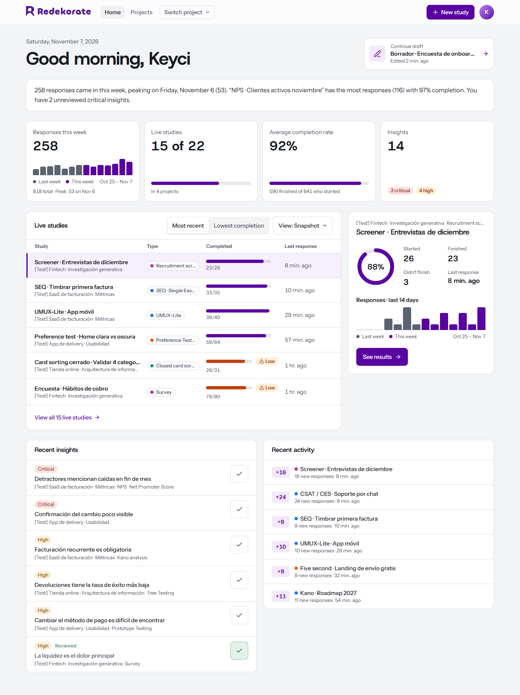

# redekorate · UX research platform

[](https://github.com/keyci1113/redekorate/actions/workflows/ci.yml)
[](LICENSE)

A self-hosted UX research tool in the spirit of Maze: create a project, pick a method, configure it, send a link to real participants and share a report with insights. Bilingual UI (Spanish / English), one Docker Compose file to run it.

[Leer en español](README.es.md)



## Features

**Research methods**

| Category | Ready |
|---|---|
| Prototypes | **Prototype Testing** and **unmoderated Usability Test**: uploaded screens with clickable zones or a single-file HTML prototype, direct/indirect success, expected-path funnel, most common paths, heatmaps and off-target clicks per screen |
| Usability | First Click (click map and correct area), Five Second, A/B Preference Test with images, Tree Testing (direct/indirect success and destinations) |
| Information architecture | Open, closed and hybrid Card Sorting (agreement per card, similarity matrix with clustering, created categories) |
| Generative | Survey, Screener, Feature prioritization (ranking + matrix), Kano model |
| Metrics | SUS (with the Sauro-Lewis scale), NPS with detractor/promoter logic, CSAT/CES, SEQ, UMUX-Lite |
| Organization | Insight repository with review status, participant panel, shareable reports per study or per project |

**Images** on blocks, branding and prototypes are optimized in the browser before upload: resized to at most 2048 px on the longest side and re-encoded as WebP (PNG or JPEG where the browser cannot encode WebP). GIFs are kept as they are, and a file is only replaced when the result is smaller.

**Blocks** combine freely in a "Blank study": Welcome, Instructions, Thank you, Open question, Multiple choice, Yes/No, Scale (numbers, stars or emojis), Ranking, Matrix, NPS, SUS, Card Sorting, Tree Test, Preference, Five Second, First Click. Every block accepts an optional image.

**Conditional logic** is written in plain language, for example "if the answer is less than 7 → go to…". It works with options, Yes/No, scales, NPS, preference, and pass/fail in tree tests and first click. Jumps only go forward, so no cycles can form.

**Fillable documents.** Each project has a Documents tab with 19 templates: UX Project Blueprint, Proto-persona, Persona canvas, User persona, User Journey Map (the emotion curve draws itself), Affinity diagram, Empathy Map, Stakeholder Map, Cognitive Mapping, User / Task Flow, Service Blueprint, Jobs To Be Done, Interview guide and notes, AEIOU observation, Behavioral observation, Diary Study, Usability test script, Usability test results (computes per-task and total rates) and Heuristic evaluation (Weinschenk or Nielsen, several evaluators, severity 0–4). Documents start empty; examples appear only as placeholder text and are never saved. They autosave, support "Save as…" into this or another project, export to **Word (.docx), PDF, Markdown and CSV** from the browser, and can be shared with a revocable read-only link. Each document has its own language.

**Participants.** A public link, no account needed, mobile-friendly, with optional informed consent. A per-project participant panel keeps a recruiting base (name, contact, tags, consent) and the history of which studies each person was invited to and how it went.

**Results.** Automatic analysis per method, per-participant detail, CSV export, insights with severity and review status, and public reports that combine one or several studies and can be revoked at any time.

## How it flows

1. **Home:** a dashboard with live studies, responses over the last 14 days, recent activity, drafts and insights.
2. **Project:** creating one takes you straight to choosing a method. Search it, filter by category or start from your question ("Can people use my design?").
3. **Template:** each method shows its blocks, a step-by-step guide, the duration and the recommended sample before you create it.
4. **Builder:** drag blocks to reorder, edit content and logic, preview on desktop or mobile, adjust branding and run a pre-publish review.
5. **Participants:** share the public link. Once a study is live, your edits are saved as a draft and participants keep seeing the published version until you press **Publish changes**; anyone mid-flow finishes with the version they started.
6. **Results:** analysis, insights and a shareable report.

## Prototype testing

**Image prototypes**

1. In Figma, select your frames and use **Export → PNG 2x**.
2. In the builder, open **Prototypes** and drop all the screens at once; the file name becomes the screen name.
3. Draw clickable zones by dragging over each screen and choose where they lead (another screen or "back"). Zones can be moved and resized, and **Try** mode lets you navigate the prototype.
4. In each task choose the start screen, the goal screen and, optionally, the expected path. Screens are resized to at most 2048 px and re-encoded as WebP in your browser before upload, so even 2x desktop exports stay light.
5. The participant sees the task, navigates the prototype inside a phone or desktop frame (full screen on their phone) and can mark "I can't complete it". Every click is stored with coordinates, path and timings.

**HTML prototypes** (for example, made with Claude)

1. Ask Claude for the prototype as **a single .html file** and download it (a `.jsx` component will not work).
2. In **Prototypes**, create a new one and use **Upload HTML**. There are no zones to draw.
3. Navigate it in the editor: every screen you visit appears under **Detected screens**. Screens are recognized by a `data-screen="Name"` attribute, by the URL `#` hash or by the visible `<h1>`. The editor includes a ready-to-copy instruction to ask Claude to add `data-screen` attributes.
4. Once screens are detected, define the **flow** in the right panel: where it starts, where it ends, which screens it passes through and the instructions for the participant. When a task opens, the prototype is asked to show the start screen: by URL hash if it has one, otherwise by tapping the element with that name, so a start screen that sits behind a login can't be reached unless the prototype exposes it by hash (the Claude instruction in the editor asks for that). For steps inside a screen, such as opening a tab, add **required interactions**: press *Record clicks* and tap the elements in the preview, or type the element's text; any step can become the goal. Tasks that use the prototype pick that flow up as their goal, expected path, required interactions and description; you can still adjust each task. Results show how many participants performed each interaction and how long it took them. Without a goal, the participant taps "I'm done" (self-reported success, not verified).
5. The path, timings and every click with the element's text are stored. Instead of heatmaps, results show the most-tapped elements per screen and **clicks with no response** (taps on something that is not interactive).

**Published link** (Figma Make, a deployed site…)

1. Publish the prototype and copy its public link. For Figma Make that is the `….figma.site` address, not the editor URL.
2. In **Prototypes**, paste it under **Published link**. The server checks that the site allows being embedded and the prototype is shown as is inside the task.
3. Nothing of ours runs on that site, so only the time and the participant's own "I'm done" or "I can't complete it" are recorded; there are no clicks, screens or heatmaps. claude.ai blocks embedding, so a Claude link is refused with a pointer to the HTML upload above.

> **Why not just paste the Claude link?** claude.ai does not allow other sites to embed its artifacts in an iframe (`frame-ancestors`), so the prototype is uploaded as a file. The server injects a tracking script and serves it with a CSP `sandbox` (opaque origin): the HTML cannot read the session or call the API, and it can only be embedded from the app.

> **Why not connect to Figma directly?** Figma's Embed API is free, but it only sends events when the participant is signed in to Figma (confirmed by Figma support in January 2026), and clicks are relative to the layer that was hit, not to the screen. With uploaded screens any anonymous participant works and heatmaps are accurate.

## First run and help

A new account opens a short welcome wizard: profile (photo, name, interface language), workspace (personal, or create an organization), a first project and a first study from a recommended method. Every step can be skipped and *Finish later* leaves at any point; the account remembers it, so the wizard shows once per person, not per browser. People who arrive through an organization or project invitation skip the steps they don't need.

The Home shows a *Getting started* checklist (project, study, publish, first response, shared report) checked off from real data until it is complete or hidden. *Help and concepts* in the account menu has how-tos for the main tasks and a glossary of the words the interface uses, and lets you replay the wizard.

## Users and roles

Every instance has two roles. The first account ever created is the **admin**; everyone else is a **member**.

- **Members** work in their own projects, exactly as before.
- **Admins** see a *Users* page in the account menu where they invite people by email (the invitation is valid for 7 days and works even with `ALLOW_REGISTRATION=false`), change roles, and disable or reactivate accounts. Disabling an account closes its sessions immediately. There must always be at least one active admin, and you can't demote or disable yourself.

Without SMTP configured, the admin gets the invitation link to copy instead of an email being sent.

**Project collaborators.** The person who creates a project owns it and can add any existing account from the project's *Collaborators* tab with one of three roles:

| Role | Can |
|---|---|
| Editor | Create and change studies, documents, insights, participants and shared reports |
| Commenter | Everything read-only can, plus leave comments on the project, on study results and on documents |
| Read-only | Open results, documents and reports; the builder redirects to results and documents open read-only |

Only the owner adds or removes people, archives or deletes the project, or moves it into an organization. Collaborators can leave a project themselves. The dashboard counts shared projects too, and any collaborator can preview a draft study.

**Organizations.** Anyone can create an organization from the account menu: a workspace with a name, a logo and a color, for a company, a team or a personal studio. A project is either personal or belongs to one organization (chosen when creating it, or moved later by its owner from *Edit project*).

| Organization role | Can |
|---|---|
| Owner | Everything, including deleting the organization |
| Admin | Change the profile, add or remove people, send invitations |
| Member | See every project of the organization as a **commenter** |

Owners and admins act as owners of every organization project. When a project has an explicit collaborator role and an organization role, the higher one wins. New studies in an organization project start with the organization's logo and color as their brand, and public reports show the logo next to Redekorate's. People who already have an account are added by email; people who don't get a 7-day invitation link that creates the account and joins the organization. Deleting an organization never deletes projects: they become personal projects of their owners again.

## Security and privacy

- Passwords hashed with bcrypt, sessions in an `httpOnly` cookie with a short-lived JWT, revocable from "Sign out everywhere".
- Brute-force protection, constant-time login responses, single-use password-reset tokens.
- CSRF guard, strict CSP, HSTS, zod validation on every input, parameterized SQL, ownership checks on every resource.
- Uploads validated by magic bytes (SVG rejected), random file names, served with a no-script CSP. HTML prototypes run in a sandboxed iframe with an opaque origin.
- Participants' IP and full user agent are never stored, only the device class. Public reports never include participant data.

The full list is in [SECURITY.md](SECURITY.md), together with how to report a vulnerability.

## Deploy on your own server

```bash
cp .env.example .env        # fill in JWT_SECRET, DB_PASSWORD, APP_URL and SMTP
docker compose up -d --build
```

The app listens on `127.0.0.1:4000`. Put it behind Caddy or Nginx with HTTPS:

```
research.yourdomain.com {
  reverse_proxy localhost:4000
}
```

After creating your account, set `ALLOW_REGISTRATION=false` and restart. Images and the database live in Docker volumes (`uploads`, `pgdata`); include them in your backups. Do not change `DB_PASSWORD` after the first deploy: PostgreSQL only reads it when the volume is created.

### Automatic deploys (GitHub Actions)

`.github/workflows/deploy.yml` builds and restarts the app on every push to `main` (or manually from the Actions tab). It runs on a self-hosted runner installed on the same VPS:

1. On the VPS, install Docker and add the runner user to the `docker` group.
2. Register the runner under *Settings → Actions → Runners → New self-hosted runner* (Linux) and install it as a service (`sudo ./svc.sh install && sudo ./svc.sh start`).
3. Create the `ENV_FILE` secret under *Settings → Secrets and variables → Actions* with the full contents of your `.env`.

If you fork the project, disable this workflow or remove the runner label; it will not run on GitHub-hosted runners by design.

## Local development

```bash
npm install
createdb redekorate          # default credentials: redekorate / redekorate
npm run dev                  # API on :4000, web on :5173
```

Migrations run automatically when the server starts. Without SMTP, the password-reset link is printed to the server console. `npm run seed:test` fills the database with sample projects for every method (needs Python 3). See [CONTRIBUTING.md](CONTRIBUTING.md) for the full developer guide.

## Architecture

```
server/  Express 5 · PostgreSQL · zod · helmet · express-rate-limit · multer
  migrations/   001 base schema · 002 security, reset and uploads · 003 documents
                004 participant panel · 005 project reports · 006 insight review · … · 012 organizations and comments · 013 onboarding
  src/routes/   auth · dashboard · projects · studies · insights · participants · documents · uploads · public · admin · orgs
  src/lib/i18n.ts   server messages in ES/EN (by the x-lang header)
web/     React 19 · Vite · Tailwind 4 · React Router
  src/blocks/      types · registry · Editor · Runner · Results · LogicEditor · logic · validate
  src/templates/catalog.ts   methods, guides and default blocks
  src/docs/        fillable templates (templates.tsx), sections, journey, affinity, matrix, heuristics
  src/lib/i18n.tsx · en.ts   UI language (ES/EN) and the English dictionary
```

## Languages

The whole interface switches between **Spanish and English** (ES/EN selector in the sidebar and on the login page).

- The UI language is per person and saved in the browser.
- Each study has its own **study language** (Design → Language): participants and the shared report see it in that language regardless of who created it.
- New blocks are created in the study language; documents, in the document language.
- To translate a new string: wrap it in `t("texto en español")` and add the translation to `web/src/lib/en.ts`. Missing translations fall back to Spanish.

## Roadmap

- ✅ **Phase 1:** projects, surveys and metrics, results, insights and reports.
- ✅ **Phase 2:** images, conditional logic, drag & drop, ranking, matrix, yes/no, card sorting, tree test, preference, five second, first click, per-study branding, consent, pre-publish review, dashboard, account management and security hardening.
- ✅ **Phase 3:** Prototype Testing with uploaded screens, clickable zones, expected paths, direct/indirect success, per-screen heatmaps and unmoderated usability test. HTML prototypes with screen detection.
- ✅ **Phase 4:** fillable documents, Kano model, bilingual UI and Spline Sans headings.
- **Phase 3.1 (optional):** fixed bars (header/tab bar) in prototypes, overlays, and screen, camera and microphone recording with consent.
- **Phase 5:** moderated sessions with recording and transcription, personas linked to insights.
- **Phase 6:** Research Plan, project collaborators with roles, 2FA.

## Contributing

Issues and pull requests are welcome. Read [CONTRIBUTING.md](CONTRIBUTING.md) first: it covers the dev setup, commit conventions, the i18n rules and how to add a research method. Please follow the [Code of Conduct](CODE_OF_CONDUCT.md).

## License

redekorate is free software under the [GNU Affero General Public License v3.0](LICENSE). You can run, study, modify and redistribute it, and if you offer a modified version to users over a network you must make your modified source available to them under the same license.

Copyright © 2026 Keyci Padilla and contributors.
